# Домашнее задание 15-06. Практическое применение Docker

## Задача 0. Проверка Docker Compose

Проверил установку Docker Compose.

- `docker-compose` — не установлен.
- `docker compose` — установлен, версия v5.5.0.

Версия соответствует требованиям задания.

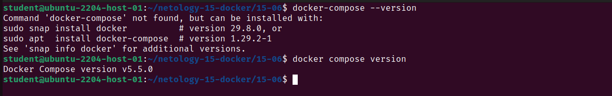

## Задача 1. Сборка Python-приложения

Создал Fork репозитория [shvirtd-example-python](https://github.com/netology-code/shvirtd-example-python) в своём GitHub:

https://github.com/public-zero/netology-15-06

Создал `Dockerfile.python` с multi-stage сборкой на основе `python:3.12-slim`.

- Первый этап — установка библиотек из `requirements.txt`.
- Второй этап — копирование библиотек и файлов приложения.

Добавил `.dockerignore` для исключения ненужных файлов.

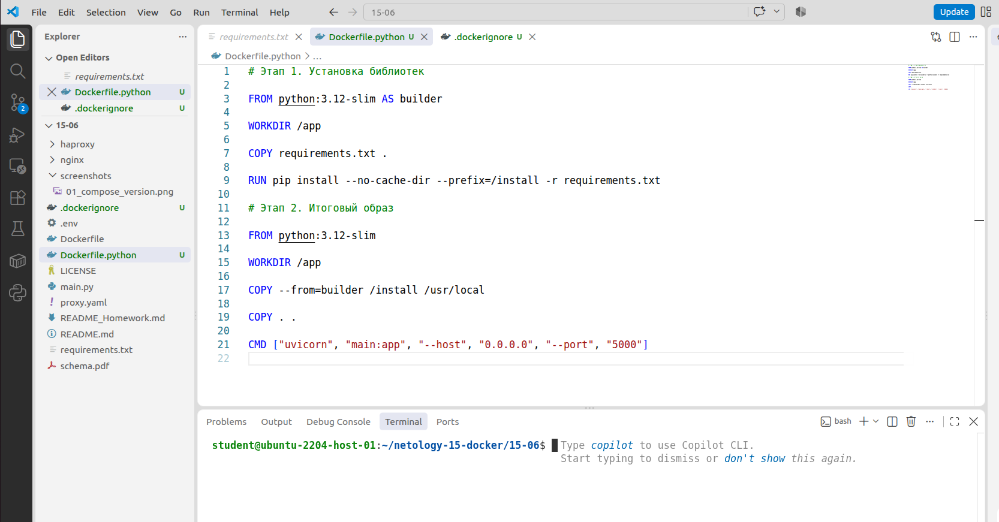

Собрал Docker-образ:

    docker build -f Dockerfile.python -t netology-15-06-web .

Образ успешно собран. Размер — 269 MB.

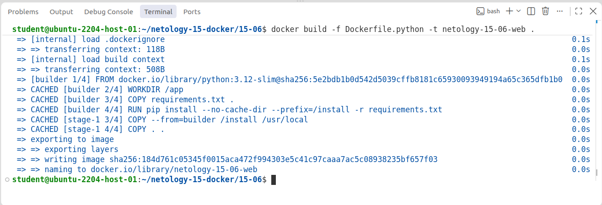

Запустил контейнер и проверил работу Uvicorn через `docker logs`. Приложение успешно запустилось на порту 5000.

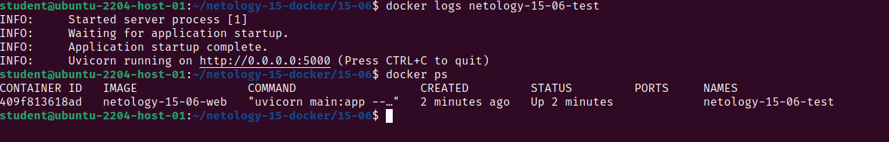

После проверки остановил и удалил тестовый контейнер.

## Задача 3. Docker Compose

Создал `compose.yaml` для запуска приложения FastAPI и базы данных MySQL.

Через `include` подключил `proxy.yaml` с настройками Nginx и HAProxy.

Настроил сеть `backend`:
- `web` — 172.20.0.5
- `db` — 172.20.0.10

Пароли и настройки базы данных берутся из `.env`.

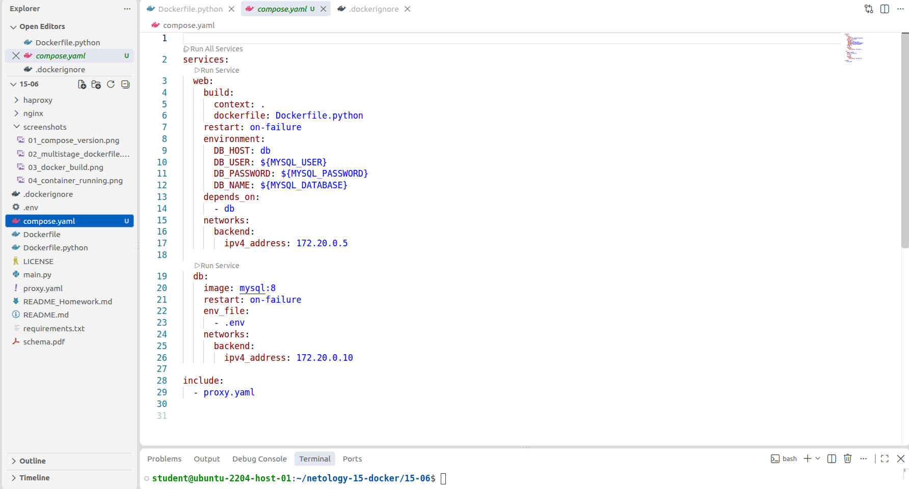

Запустил проект командой:

    docker compose up -d

Все четыре контейнера успешно запустились.

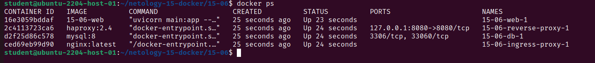

Проверил работу приложения:

    curl -L http://127.0.0.1:8090

Приложение вернуло время запроса и IP-адрес.

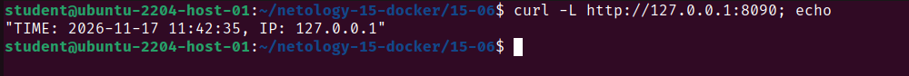

Подключился к MySQL, проверил базу `virtd` и таблицу `requests`. В таблице появились две записи о HTTP-запросах.

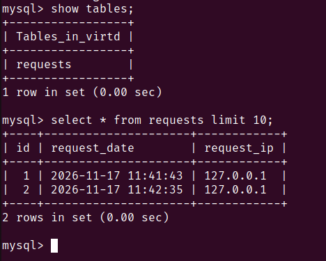

Остановил проект командой:

    docker compose down

## Задача 4. Развёртывание в Yandex Cloud

Создал виртуальную машину `netology-15-06` в Yandex Cloud с Ubuntu 22.04, 2 vCPU и 2 ГБ RAM.

Подключился по SSH с помощью созданного ключа.

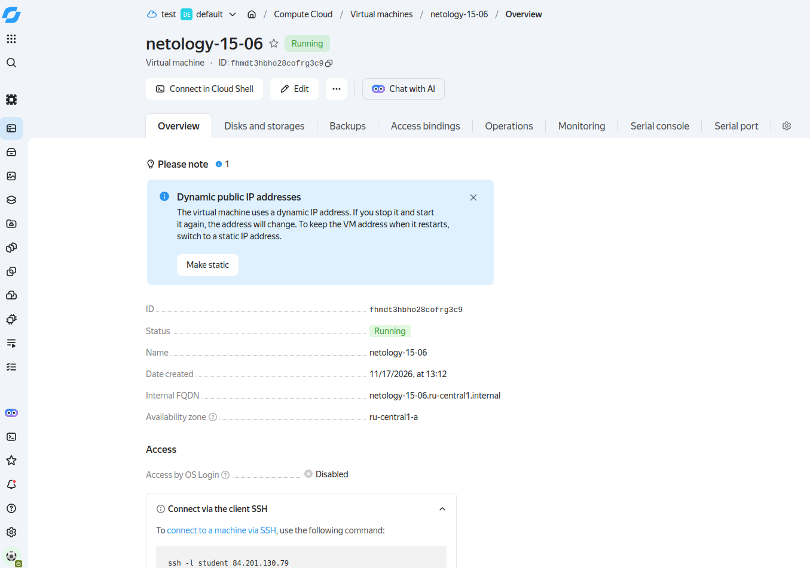

Установил Docker и Docker Compose.

Создал скрипт `deploy.sh`, который скачивает проект с GitHub в `/opt/netology-15-06` и запускает контейнеры через Docker Compose.

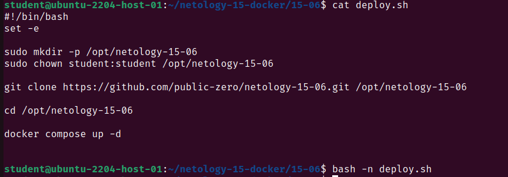

Запустил скрипт на облачной машине. Все четыре контейнера успешно запустились.

Проверил доступность приложения через Check-Host по адресу `http://84.201.130.79:8090`.

Проверка из разных стран показала успешные ответы HTTP 200 OK.

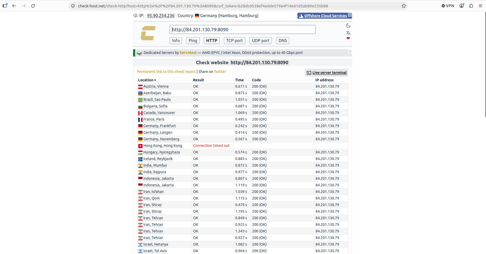

Подключился к MySQL на облачной машине и проверил таблицу `requests`. В таблице появились записи с IP-адресами внешних клиентов.

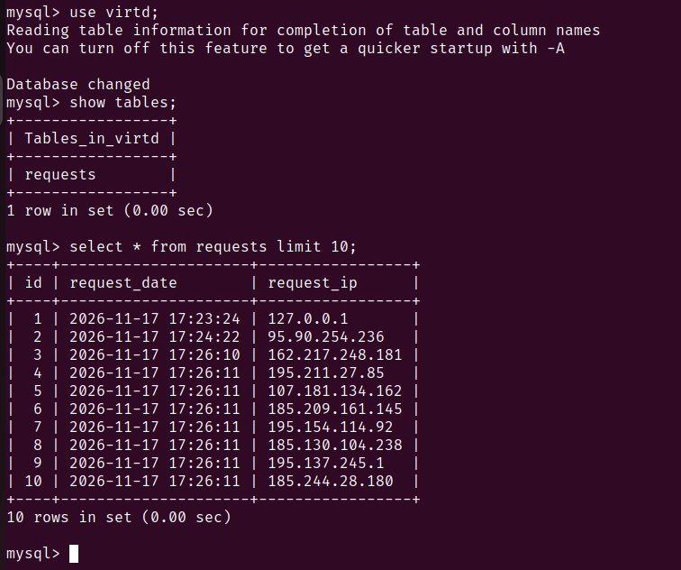

